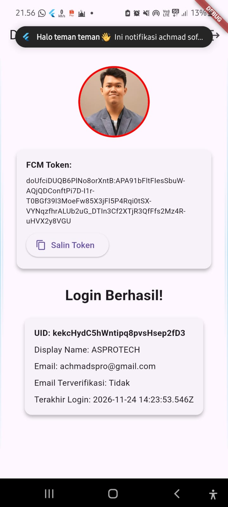
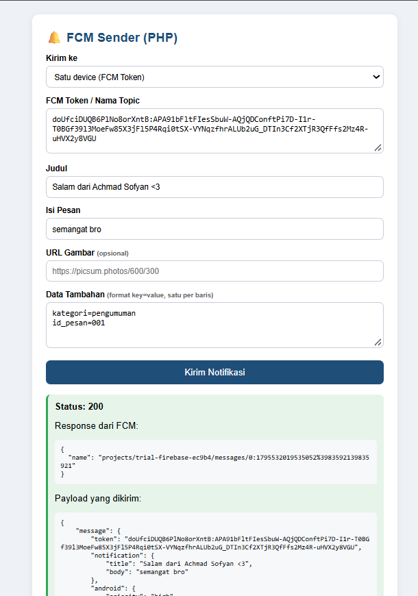
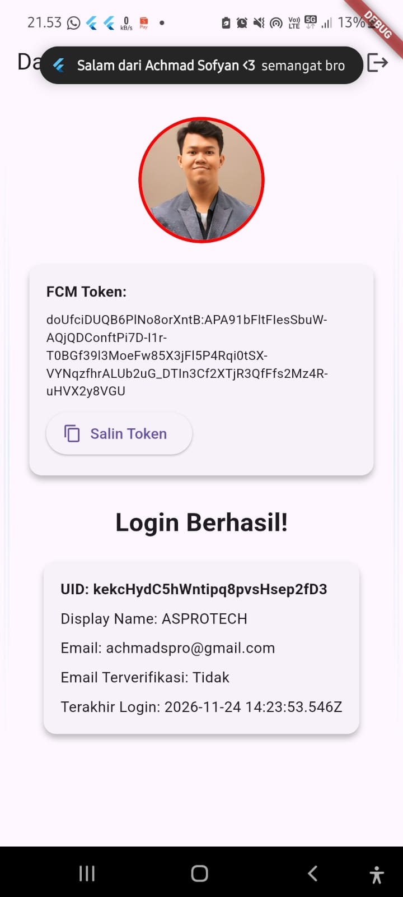
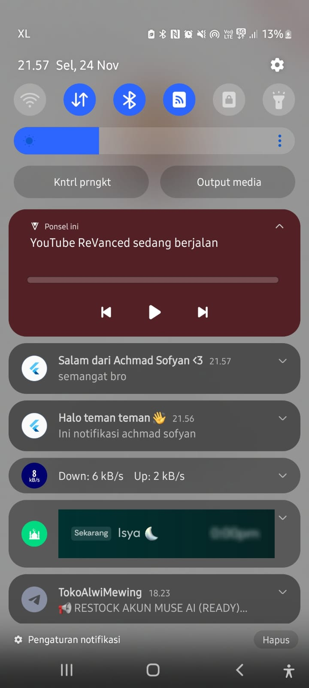

# Trial Firebase - Flutter

Project percobaan implementasi Firebase pada aplikasi Flutter
dengan menggunakan Firebase Authentication dan Firebase Cloud
Messaging (FCM).

Project ini dibuat untuk mempelajari proses autentikasi pengguna
serta pengiriman push notification melalui Postman dan Backend PHP.

## Identitas Mahasiswa

| Keterangan    | Data                 |
| ------------- | -------------------- |
| Nama          | Achmad Sofyan        |
| NIM           | 1124160171           |
| Program Studi | Software Engineering |

## Fitur Aplikasi

- Autentikasi pengguna menggunakan Firebase Authentication.
- Menampilkan informasi dan foto profil pengguna.
- Mendapatkan FCM Token dari perangkat.
- Menyalin FCM Token.
- Menerima push notification dari Firebase Cloud Messaging.
- Pengiriman notifikasi menggunakan Postman.
- Pengiriman notifikasi menggunakan Backend PHP.

## Teknologi yang Digunakan

- Flutter
- Dart
- Firebase Authentication
- Firebase Cloud Messaging (FCM)
- Postman
- PHP
- Firebase Cloud Messaging HTTP v1 API

## Alur Pengiriman Notifikasi

1. Pengguna melakukan login pada aplikasi Flutter.
2. Aplikasi mendapatkan FCM Token dari perangkat.
3. FCM Token digunakan sebagai tujuan pengiriman notifikasi.
4. Postman atau Backend PHP mengirimkan request ke Firebase.
5. Firebase meneruskan notifikasi ke perangkat pengguna.
6. Notifikasi diterima dan ditampilkan pada perangkat Android.

## Hasil Pengujian

### 1. Pengiriman Notifikasi Menggunakan Postman

Pengujian pengiriman push notification dilakukan menggunakan
Postman melalui Firebase Cloud Messaging API.

**Request pengiriman notifikasi:**

<p align="center">
  
</p>

**Hasil notifikasi pada aplikasi:**

<p align="center">
  
</p>

### 2. Pengiriman Notifikasi Menggunakan Backend PHP

Pengiriman notifikasi dilakukan melalui halaman Backend PHP
yang terintegrasi dengan Firebase Cloud Messaging.

**Tampilan Backend PHP:**

<p align="center">
  
</p>

**Hasil notifikasi pada aplikasi:**

<p align="center">
  
</p>

### 3. Notifikasi pada Notification Panel

Notifikasi yang dikirim melalui Postman dan Backend PHP
ditampilkan pada notification panel perangkat Android.

<p align="center">
  
</p>

## Cara Menjalankan Project

Pastikan Flutter SDK dan konfigurasi Firebase sudah tersedia.

Install dependencies:

```bash
flutter pub get
```

Jalankan aplikasi:

```bash
flutter run
```

## Kesimpulan

Berdasarkan hasil pengujian, Firebase Authentication dan Firebase
Cloud Messaging berhasil diimplementasikan pada aplikasi Flutter.

Pengiriman push notification dapat dilakukan melalui Postman
maupun Backend PHP dan diterima oleh perangkat Android yang
terdaftar menggunakan FCM Token.
